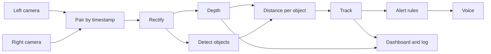

# Architecture

## The pipeline

Each frame pair goes through the same steps, and depth and detection run at the same time
on two worker threads.

`Pipeline.step()` in `src/sirius/pipeline.py` does one pass and returns everything the
dashboard needs: the rectified images, the depth map, the tracked objects, what was spoken,
camera health, and a log record.

## Modules

| Module | Job |
|---|---|
| `devices.py` | Lists DirectShow video devices by parsing `ffmpeg -list_devices`, and finds a camera by a fragment of its device path. |
| `capture.py` | One `CameraGrabber` per camera. It runs ffmpeg, which passes the camera's own JPEG frames through untouched, splits the byte stream into JPEGs, decodes them, and keeps only the newest frame with its arrival time. It restarts ffmpeg if a camera stops for over a second. |
| `pairing.py` | Pairs the newest left and right frames if they arrived within one frame period (33 ms at 30 FPS) of each other, and never returns the same pair twice. |
| `source.py` | The `StereoSource` interface (`start`, `stop`, `read`, `health`) and the live two-camera source. |
| `replay.py`, `recorder.py` | Record pairs to disk and play them back with their original timing. |
| `health.py` | Per-camera frame age, brightness and colour saturation. A camera is "fresh" if its newest frame is under 200 ms old and not dark. |
| `identity.py` | Matches features between the two images and checks that content appears further right in the left image, which catches swapped cameras. |
| `calib/` | ChArUco board generation and detection, stereo calibration, and rectification. See [calibration.md](calibration.md). |
| `depth/` | The `DepthEstimator` interface and three methods: SGBM, Fast-FoundationStereo and single-camera Depth Anything. See [depth.md](depth.md). |
| `detect.py` | D-FINE object detection, limited to the classes SIRIUS announces. |
| `fusion.py` | Distance for each detected object: the median depth over the centre half of its box, or nothing if under half of that area has valid depth. Also the distance zones. |
| `track.py` | Keeps an identity on each object across frames by box overlap, and smooths its distance. |
| `alerts.py` | Decides what to say. See [alerts-and-voice.md](alerts-and-voice.md). |
| `voice.py` | Windows speech (SAPI), a mutable wrapper the dashboard can silence, and a recording double for tests. |
| `pipeline.py` | Wires one step together and enforces the speaking rules. |
| `viewer/` | The browser dashboard. See [dashboard.md](dashboard.md). |
| `eval/bakeoff.py` | Scores depth methods against a printed target at known distances. |
| `cli.py` | The `sirius` command. See [commands.md](commands.md). |

## Coordinates and distance

Everything is measured in the left camera's rectified frame: x to the right, y down, z
forward. Distances are reported from the midpoint between the two lenses, because that is
where a person wearing the glasses would measure from. `depth/geometry.py` holds the three
formulas:

- depth from disparity: `z = fx * baseline / disparity`
- straight-line distance from the lens midpoint: `sqrt((x - baseline/2)^2 + y^2 + z^2)`
- bearing: the horizontal angle from the midpoint, positive to the right

The spoken distance is the straight-line distance, not depth along the camera axis. At 30
degrees off-centre the two differ by about 15%.

## Swappable parts

Four interfaces carry the design, so the bench rig can later be replaced piece by piece:

| Interface | Implementations today |
|---|---|
| `StereoSource` | live webcams, recorded clip |
| `DepthEstimator` | SGBM, Fast-FoundationStereo, Depth Anything (single camera) |
| `Detector` | D-FINE |
| `Voice` | Windows SAPI, silent, recording (tests) |

A network source for the Raspberry Pi node in Phase 2 would be a new `StereoSource`. Nothing
downstream changes.

## Logs

With `--log`, each frame writes one JSON line: frame time, depth and detection time in ms,
total step time, whether the cameras were fresh, each object with its distance and bearing,
what was spoken, what was muted, and when speech started.
